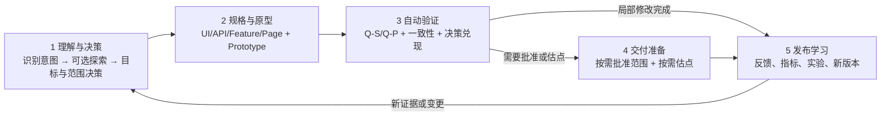
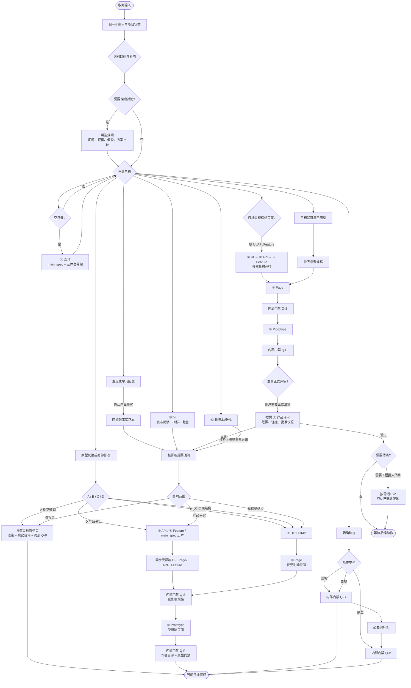

# LNY PRD Workflow 路由图

这张图描述默认工作流。步骤编号用于定位模块，实际执行按用户目标、项目状态和变更影响计算最小路径。

## PM 视图

PM 只需要记住五个阶段。括号内是内部模块，不代表每次都逐个执行。

### 五阶段与内部步骤

| PM 阶段 | 内部步骤 | 说明 |
|---|---|---|
| 理解与决策 | ①、Discovery | 归一化输入，形成问题、目标、范围和成功标准；决策可暂定或已确认 |
| 规格与原型 | ② UI、③ API、④ Feature、⑤ Page、⑥ Prototype | 按最小依赖产出方案与页面，不要求每次模块全做 |
| 自动验证 | ⑦ Q-S/Q-P、事实一致性、决策兑现检查 | 自动发现偏离并回到责任步骤，只有不可逆冲突才请求决策 |
| 交付准备 | ⑧ Review、⑨ SP | 需要正式批准时确认范围，需要工程投入时估点 |
| 发布学习 | Learning、⑩ Iter | 发布反馈回到理解与决策，必要时创建新版本 |

五阶段不是新的写入层。正式产物仍由内部步骤按原有归属维护。⑧ Review 和⑨ SP 都是交付准备中的按需动作。

## 看图规则

- **A 类**只改当前原型和视觉记录，不创建新版本，不重跑完整规格链。
- **B 类**从 UI 或 COMP 开始，只有交互契约变化时才进入 Q-S。
- **C 类**至少经过 UI、Page、Q-S、Prototype、Q-P。
- **D 类**先改事实正本，再同步下游文件，不能只改 HTML。
- **发现和学习**不是直线前置步骤。它们在获得新证据后按影响范围回流。
- **Q-S 和 Q-P**是质量门禁，判断规格和原型是否完整、可追溯、可演示。
- **⑧评审**与质量门禁位于同一 PM 阶段，但负责产品价值、范围、风险和批准决策。
- **⑨估点**只在评审确认交付范围且需要工程投入估算时进入。
- **⑩迭代**只在用户明确开启新版本时进入。

## 最小路径速查

| PM 输入 | 默认路径 |
|---|---|
| “标题左边距缩小” | A → 当前原型页 → 视觉自评 → 局部 Q-P |
| “这个按钮点击后要展开筛选” | B → UI/COMP → 必要时 Page → Q-S → Prototype → Q-P |
| “增加一个筛选入口” | C → UI → Page → Q-S → Prototype → Q-P |
| “库存字段改成可选” | D → API/Feature 正本 → 下游同步 → Q-S → Prototype → Q-P |
| “用户反馈注册后留存下降” | Learning → 证据与假设 → 按影响范围回流 |
| “继续” | 从最早未完成且与当前目标相关的责任步骤恢复 |
| “完整做完并评审” | 必要规格 → Page → Q-S → Prototype → Q-P → 自动走查 → ⑧ |

